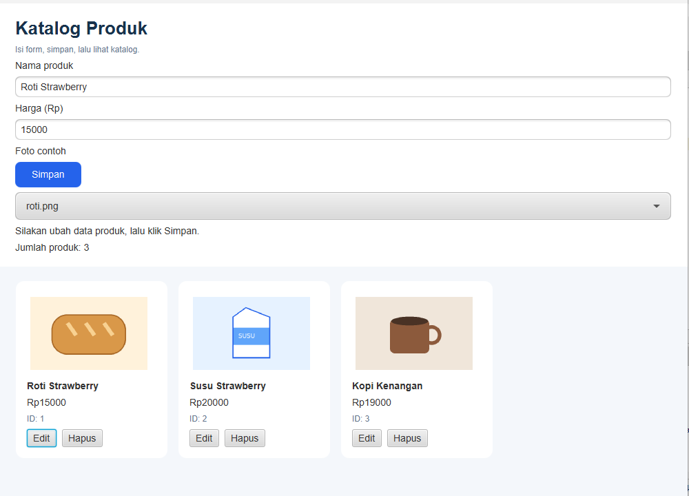
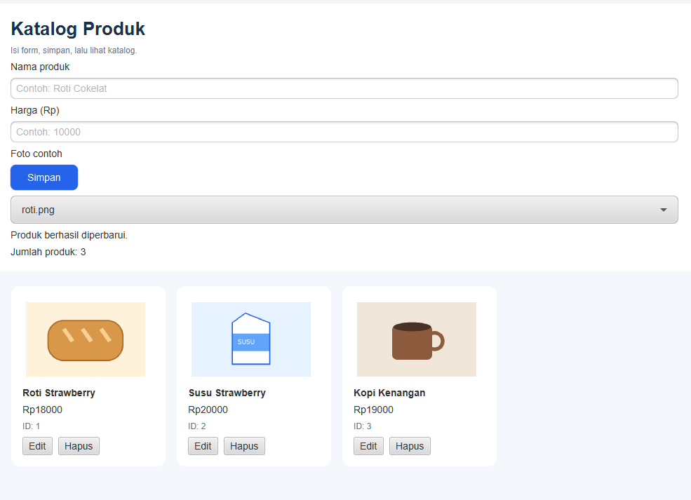
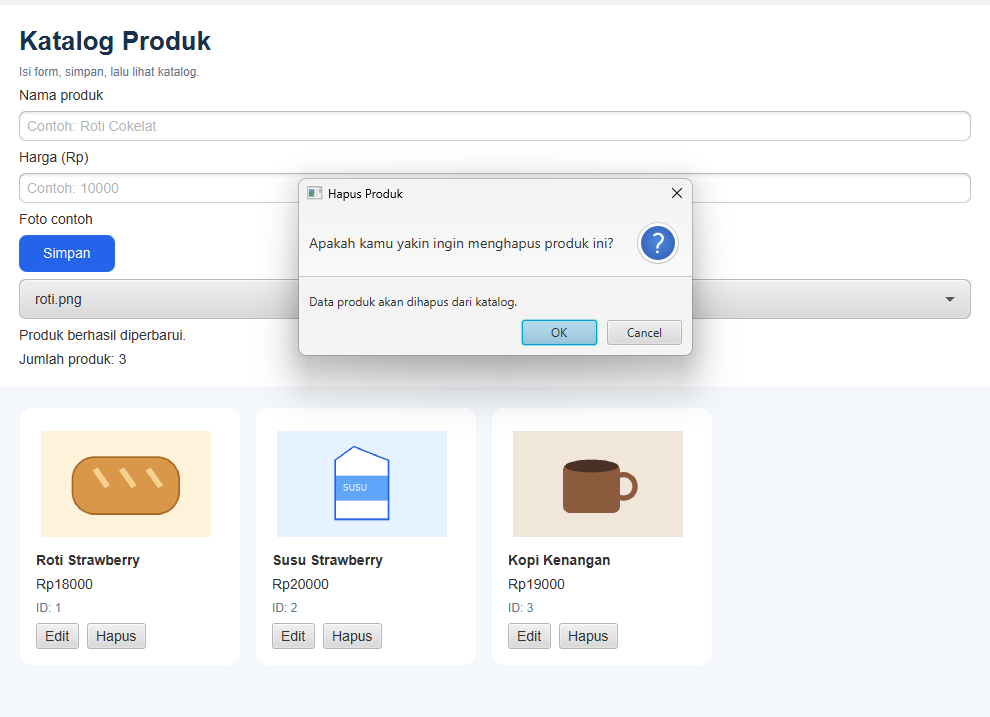
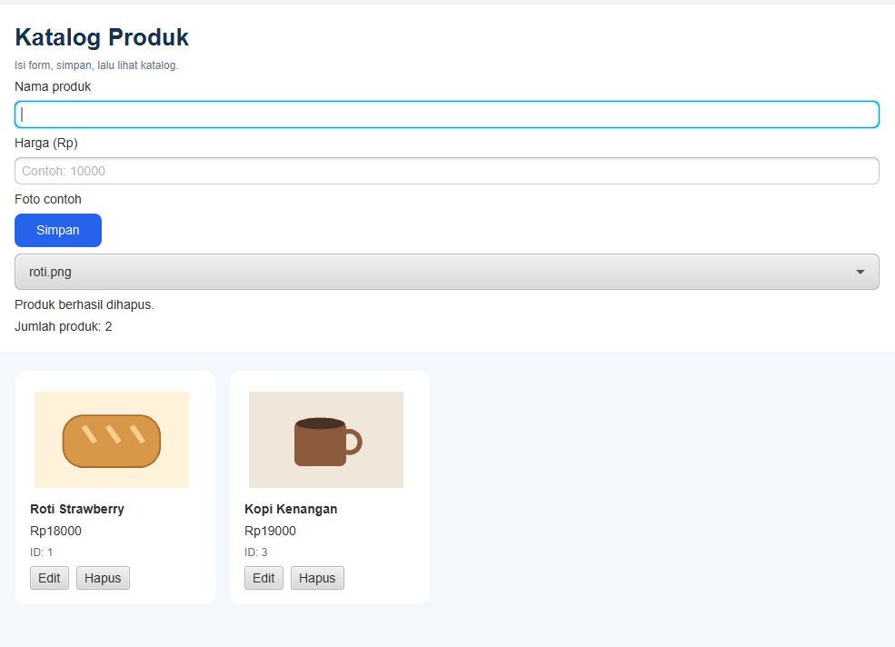

# Katalog Produk

Katalog Produk merupakan aplikasi manajemen produk berbasis JavaFX dan Maven yang digunakan untuk mengelola data produk toko. Aplikasi ini memungkinkan pengguna untuk menambahkan, mengubah, dan menghapus data produk melalui form input yang tersedia.

Setiap produk memiliki informasi berupa nama produk, harga, dan foto produk yang ditampilkan dalam bentuk kartu katalog. Aplikasi ini menggunakan **SQLite sebagai database lokal** untuk menyimpan data secara permanen sehingga data tetap tersedia meskipun aplikasi ditutup dan dijalankan kembali.

## 📋 Fitur Utama

1. **Tambah Produk**: Menambahkan produk baru dengan mengisi nama produk, harga, dan memilih foto produk.
2. **Pilih Produk**: Memilih produk yang tersedia melalui dropdown untuk melakukan pengelolaan data.
3. **Update Produk**: Mengubah informasi produk yang sudah tersimpan.
4. **Delete Produk**: Menghapus produk dari katalog dengan konfirmasi sebelum penghapusan.
5. **Foto Produk**: Menampilkan gambar produk sesuai pilihan yang tersedia.
6. **Katalog Produk**: Menampilkan seluruh produk dalam bentuk kartu yang berisi foto, nama, harga, dan ID produk.
7. **Database SQLite**: Menyimpan data produk secara lokal dan permanen.
8. **Jumlah Produk**: Menampilkan total produk yang tersimpan dalam katalog.
9. **Status Operasi**: Menampilkan informasi keberhasilan proses tambah, ubah, dan hapus produk.

## 🚀 Cara Menjalankan Aplikasi

### 1. Clone Repository

Buka terminal atau Command Prompt, kemudian jalankan perintah berikut:

```bash
git clone https://github.com/ikmahsyawala-debug/KatalogProduk.git
```

### 2. Masuk ke Direktori Project

```bash
cd KatalogProduk
```

### 3. Buka Project di Apache NetBeans

1. Buka aplikasi Apache NetBeans.
2. Pilih **File → Open Project**.
3. Pilih folder project KatalogProduk yang sudah di-clone.
4. Tunggu hingga proses pemuatan dependency Maven selesai.

### 4. Jalankan Aplikasi

Buka terminal pada direktori utama project, kemudian jalankan perintah:

```bash
mvn clean javafx:run
```

Tunggu hingga proses build selesai. Jika berhasil, aplikasi Katalog Produk akan terbuka dan siap digunakan.

**Catatan:** Pastikan JDK dan Maven sudah terpasang serta konfigurasi JavaFX dan SQLite pada project sudah sesuai.

## 📸 Tampilan Aplikasi

### 1. Form Input dan Katalog Produk

Menampilkan form untuk memasukkan nama produk, harga, dan memilih foto produk.


### 2. Hasil Penghapusan Produk

Menampilkan katalog setelah salah satu produk berhasil dihapus beserta informasi jumlah produk terbaru.



### 3. Konfirmasi Penghapusan Produk

Menampilkan pesan konfirmasi sebelum produk dihapus dari katalog.



### 4. Update Produk

Menampilkan proses pemilihan produk dan perubahan informasi produk melalui form input.



### 5. Hasil Update Produk

Menampilkan katalog setelah informasi produk berhasil diperbarui.



---

